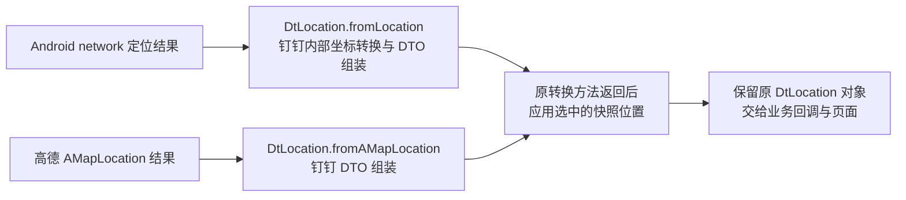

# Smartisan 整体思路与修改说明

本轮收到的 27 条定位观察记录均匹配快照，但只有 `first_entry` 的 8 条所在窗口完成闭环，`refresh` 的 19 条未完成终止对账。采集中还出现了风险插件提示。清理诊断环境并重启后，用户反馈“没有风险提示，位置正常”；提示消失的唯一原因尚不能确定。位置观察点匹配不代表考勤业务通过，本次未提交考勤。

这次修复的核心，是把钉钉内部两条实际定位路径的结果都纳入处理：保留钉钉原来的转换过程，在它返回业务定位对象后，再应用选中的快照。

`DtLocation.fromLocation` 和 `DtLocation.fromAMapLocation` 这两个具体挂钩点，来自对钉钉 APK 的反编译分析与现场验证。上游模块源码提供了旧方案覆盖范围的线索，没有直接提示这两个方法。这里所说的钉钉代码是 APK 反编译结果，不是钉钉公开发布的源码。

本次工作以 [lilu0826/Smartisan-Modern 的提交 1ed0298](https://github.com/lilu0826/Smartisan-Modern/commit/1ed0298a5d29be417d507fd79501ecb9e8c520ae) 为基线。该版本的定位处理主要是拦截高德 `AMapLocationClient.getLastKnownLocation`，以及通过 `setLocationListener` 找到并拦截 `onLocationChanged`；另外处理系统 Wi-Fi 和基站接口。由此可以判断：高德路径之外的定位来源，可能没有经过原来的位置替换逻辑。[原有定位挂钩](https://github.com/lilu0826/Smartisan-Modern/blob/1ed0298a5d29be417d507fd79501ecb9e8c520ae/migration/src/com/fuck/android/rimet/modern/ModernModule.java#L29-L61)、[Wi-Fi 与基站处理](https://github.com/lilu0826/Smartisan-Modern/blob/1ed0298a5d29be417d507fd79501ecb9e8c520ae/migration/src/com/fuck/android/rimet/modern/ModernModule.java#L63-L68)

排查先核对模块本地选择的快照与目标进程读到的远程快照，确认两端数据一致，再观察实际页面产生的定位结果。修复前的一轮有效观察得到：

| 实际来源 | 观察次数 | 快照成功解码 | 输出匹配快照 |
| --- | ---: | --- | --- |
| GAODE，高德路径 | 1 | 是 | 1 次匹配 |
| SYSTEM，系统路径 | 9 | 是 | 9 次均不匹配 |

SYSTEM 的输出坐标与高度、精度都没有匹配快照。这说明排查重点应转向“实际定位走了哪条调用链”。这是一轮观察的统计，不能直接推广为所有版本、所有页面的行为。

继续沿钉钉 APK 中的调用关系追踪，可以看到 `LocationService` 按调用者传入的 `ServiceType` 分发请求。SYSTEM 对应的实现通过 Android `LocationManager` 的 `network` provider 获取定位，随后调用 `DtLocation.fromLocation`；GAODE 对应的 `td9` 实现接收高德定位回调，随后调用 `DtLocation.fromAMapLocation`。两条路径最终都交付钉钉自己的 `DtLocation` 业务对象。

选择在转换完成后处理，有两个具体原因。第一，`fromLocation` 内部存在坐标转换调用。系统坐标与高德坐标可能处于 WGS84、GCJ-02 等不同坐标系；若提前把已经保存的高德坐标塞入系统输入，就可能被再转换一次。因此让钉钉先完成自己的转换，再覆盖最终坐标，可以避开这个重复转换问题。第二，`DtLocation` 只有 String 构造器，而且携带 `ServiceType`、成功标志等业务状态。直接套用原来依赖 `Location` 构造器的复制方法并不适合它；重新创建普通 `AMapLocation` 也会丢失业务类型。因此采用原地更新工厂返回对象的方式。

生产代码主要修改了两个文件：

| 文件 | 修改内容 |
| --- | --- |
| `migration/src/com/fuck/android/rimet/modern/ModernModule.java` | 对钉钉安装两个转换工厂挂钩；先调用原方法，再应用快照。安装过程放在通用高德客户端检查之前，使该部分不依赖客户端、监听器类的安装是否成功。 |
| `migration/src/com/fuck/android/rimet/modern/LocationTransfer.java` | 新增适用于已有业务对象的 `apply`，覆盖坐标、高度、精度及可用的地址字段；保留原有 `copy` 的行为，供旧的高德客户端路径继续使用。 |

工厂结果覆盖保留原对象的 `extras`，以及以下七项状态和来源字段：

`LocationDetail`、`LocationType`、`TrustedLevel`、`ErrorCode`、`ErrorInfo`、`CoordType`、`ConScenario`。

`ServiceType`、`isSuccess`、mock 相关标志、provider、时间和运动信息也保留原值。尤其是 `LocationDetail`，部分 SDK 的错误文本会依赖它；即使不直接调用 `setErrorInfo`，修改它也可能改变错误含义，所以需要一并保留。原来的 `copy` 仍按既有策略复制快照字段和 `extras`。

每次转换都重新读取当前选择，避免继续使用旧快照。原转换方法恰好执行一次：没有快照、快照读取失败或原结果为空时，保留原流程结果；覆盖异常被捕获后返回同一个结果对象，避免保护回退再次执行转换器。异常保护不承诺将已覆盖的字段逐个回滚。位置扰动沿用原来的受限算法，围绕保存点计算，不累计修改原始快照。

验证分为 JVM 回归测试和手机实际业务验证。现有 `ModernModuleTest` 输出 **122 条 API 102 合约断言通过**；另外的 `LocationTransferTest` 和 `AppIsolationTest` 也通过。新增测试与 fixtures 覆盖了：

- SYSTEM 首次结果先经过转换、再应用快照，以及 GAODE 下一次回调读取新选择。
- 返回对象仍是原来的 `DtLocation`，保留业务类型、状态、七项字段及 `extras`。
- 原始系统输入和快照不被修改，跨类加载器对象以及仅有 String 构造器的 DTO 可以处理。
- 缓存读取、空结果、缺失快照、解码失败及覆盖异常；原转换器不会重复执行。
- 一个挂钩失败时其他挂钩继续安装，应用端类在没有模块 API 的环境中仍能加载。

这些 fixtures 用于验证 JVM 层面的调用和对象契约，不替代 Android 真机的 Parcel 格式与业务验收。另外补充了 `migration/java_tools.py`，并接入构建、测试脚本，按操作系统选择 Java 工具名称，支持 `JAVA_HOME` 与 PATH，解决原脚本写死 Windows `.exe` 路径导致的 macOS 构建问题。

最初的 16 项自建 Probe 通过，只能证明主动调用的接口路径、快照读取及相关挂钩能够工作；它没有充分覆盖实际页面的 SYSTEM 首次定位，不能据此认定全部业务路径已经生效。后续改为观察自然发生的下游 `i71.d(String, boolean, DtLocation)` 调用，不再以主动构造的接口调用代替业务路径。上面的 1 次 GAODE、9 次 SYSTEM 是修复前诊断数据，与以下修复后记录分开统计。

| 修复后观察阶段 | 来源 | 已收到回调 | 匹配快照 | 窗口质量 |
| --- | --- | ---: | ---: | --- |
| `first_entry` | SYSTEM | 7 | 7 | 与下一阶段边界闭环 |
| `first_entry` | GAODE | 1 | 1 | 与下一阶段边界闭环 |
| `refresh` | SYSTEM | 19 | 19 | 未闭环，终止 summary 未持久化 |
| 合计 | 已观测来源 | 27 | 27 | 整场统计不完整 |

这里的“匹配”指该观察点收到的 DTO 与快照满足坐标容差、高度/精度及 15 项地址字段比较。`first_entry` 的闭环只覆盖观察器就绪并标记阶段后的定义窗口；冷启动早期和观测缺口的回调数量未知。`refresh` 虽已收到 19 条匹配记录，终止 summary 请求超时，已有 summary 不能覆盖全部回调，因此不能称为刷新完整统计或整场完整通过。

现场出现的弹窗标题为“温馨提示”，提示原文为：

> 当前手机疑似安装风险插件进行虚拟打卡，请卸载或关闭风险插件后重新打卡。

按钮为“取消”和“拍照证明”。公开文档仅保留该提示文本，原截图包含个人、单位及地址信息，不公开。位置匹配与这条业务风险提示是不同的结果；本次没有提交打卡、签到或拍照证明，也没有绕过风险检测。

已停止扩大 Frida 测试，清理临时诊断服务和端口转发，恢复临时屏幕常亮设置，并结束钉钉进程后重新启动。用户随后反馈“没有风险提示，位置正常”。这支持提示与诊断环境相关的判断，但清理同时伴随重启和时间变化，没有独立控制这些变量，不能证明 Frida 是唯一原因。该对照证据为用户反馈，没有补充截图核验；保留因果未定的结论。

修复代码已提交到 [Rk2157/Smartisan-Modern 的 fix/initial-location-system 分支](https://github.com/Rk2157/Smartisan-Modern/tree/fix/initial-location-system)，并建立 [PR #1](https://github.com/Rk2157/Smartisan-Modern/pull/1)。采集工具位于 `tools/diagnostics/`，本轮口径、质量与限制见[去标识回调统计报告](callback-statistics-report.md)。
